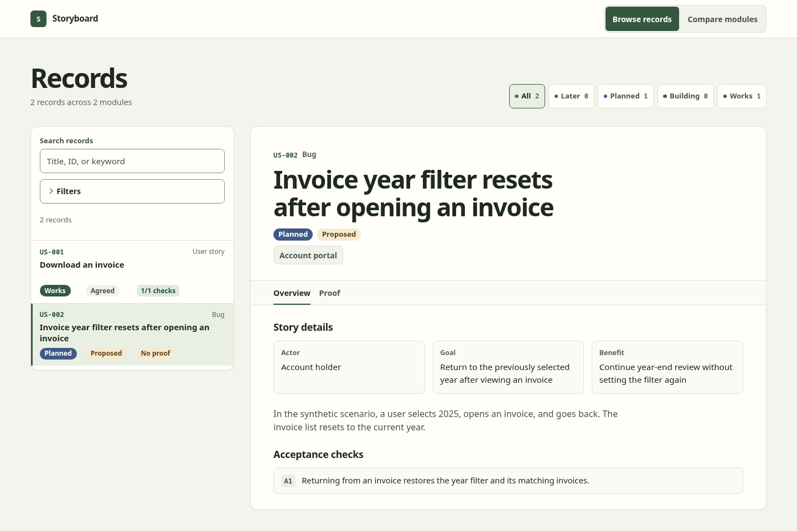
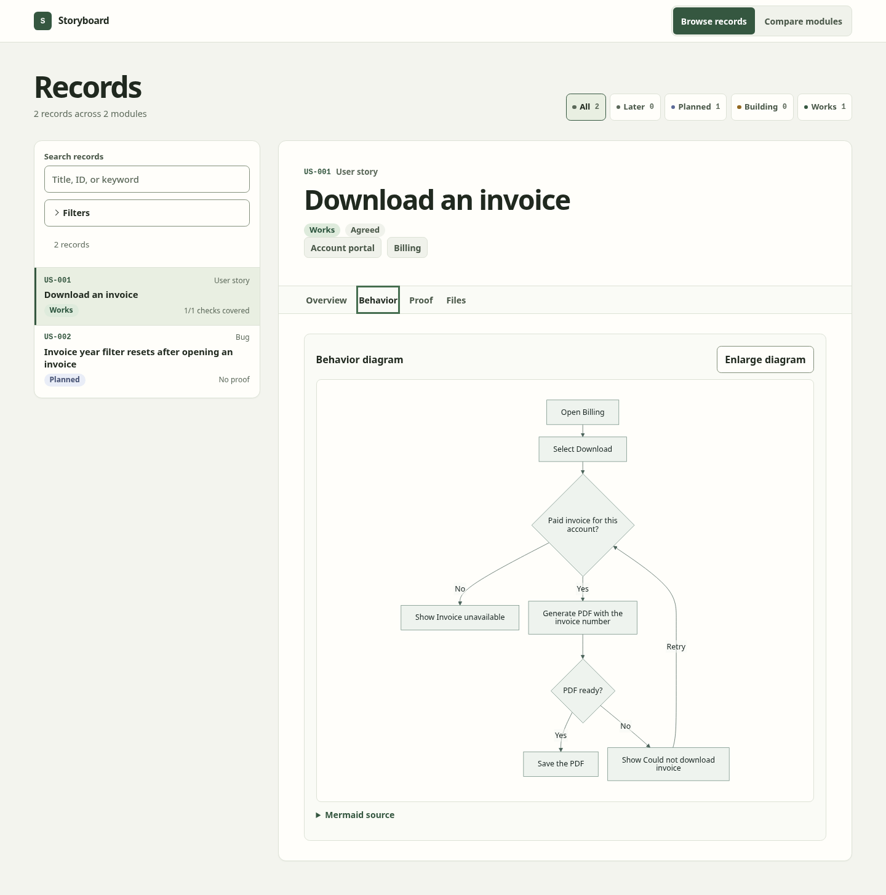

# Storyboard for Codex

Create user stories in Codex, review them in Git, and browse them on GitHub Pages.

Storyboard searches for existing work before it creates a record. Each record keeps the user outcome, affected modules, delivery and review states, and proof together in files your team can review in a pull request.

[Install](#install) · [Local dashboard](#start-from-the-command-line) · [GitHub Pages](#publish-with-github-pages) · [Usage guide](docs/usage.md)



- **Find and classify work.** Search by title, outcome, and keywords. Track stories, bugs, technical work, and research in one catalog.
- **See what changes.** Filter by affected module, then pin selected modules side by side in the comparison view.
- **Review behavior and proof.** Keep review separate from delivery. Mark agreed work as **Works** when every acceptance check has passing log or image proof. Add Mermaid diagrams, screenshots, PDFs, and links for context.
- **Publish a static view.** Browse locally or deploy on GitHub Pages. The default export includes story text and proof coverage. It includes individual proof files and attachments when they carry `"publish": true`.

## Install

If you have access to this GitHub repository, add its marketplace from the Codex CLI:

```sh
codex plugin marketplace add perara/storyboard-codex
codex plugin add story-workflow@storyboard
```

For an existing local checkout, run this from the checkout root:

```sh
codex plugin marketplace add "$PWD"
codex plugin add story-workflow@storyboard
```

Open a Codex chat for the project you want to track. Invoke the **Storyboard** plugin or ask Codex:

> Set up Storyboard for this repository.

> Check whether we already cover downloading a paid invoice. If it is new, draft one user story with affected modules and observable acceptance checks.

> Add this screenshot to the invoice story as evidence for acceptance check A1.

## Start from the command line

Python 3.9+ and Git are enough to use Storyboard without Codex. From your **target project**, point to the Storyboard checkout to create the catalog and local preview:

```sh
python3 -B /path/to/storyboard-codex/plugins/story-workflow/skills/story-workflow/scripts/story_workflow.py bootstrap
python3 -B tools/storyboard/scripts/story_workflow.py preview --serve
```

Open the localhost URL printed by the preview command. Git stores the source records under `stories/`; the dashboard is rebuilt from those files. [Try the example catalog and see the CLI reference.](docs/usage.md)

## Publish with GitHub Pages

Ask Codex to **set up Storyboard for GitHub Pages**, or add `--pages` to the bootstrap command. Review and commit the setup files through your normal pull request process. For a new Pages site, choose **GitHub Actions** under **Settings → Pages → Source**. Pull requests validate the catalog. Pushes to the default branch publish it once Pages is configured. For a repository with a Pages site already in use, add Storyboard to that site's publishing workflow. [GitHub Pages setup](https://docs.github.com/en/pages/getting-started-with-github-pages/configuring-a-publishing-source-for-your-github-pages-site)

## Review the behavior

Open a record's **Behavior** tab to read or enlarge its Mermaid diagram. The **Proof** and **Files** tabs keep observed results and supporting material within reach. The screenshot below uses the bundled synthetic invoice story.



[Full usage guide](docs/usage.md) · [Example catalog](plugins/story-workflow/examples/stories) · [Record schema](plugins/story-workflow/schemas/storyboard.schema.json)
